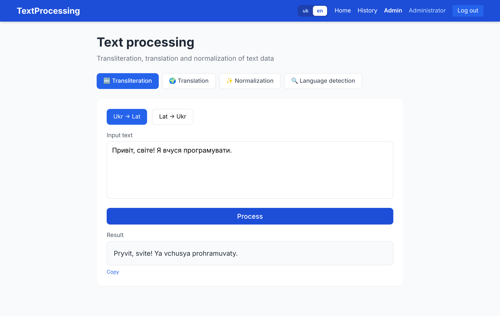
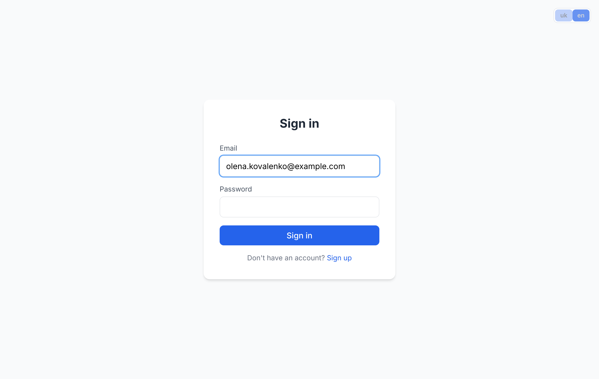
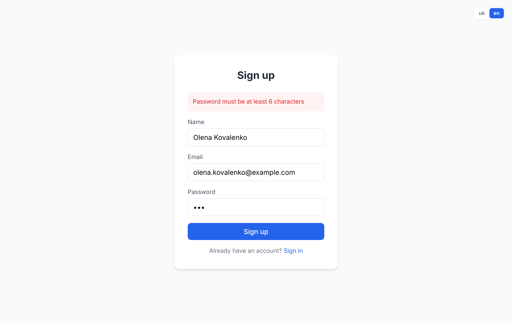
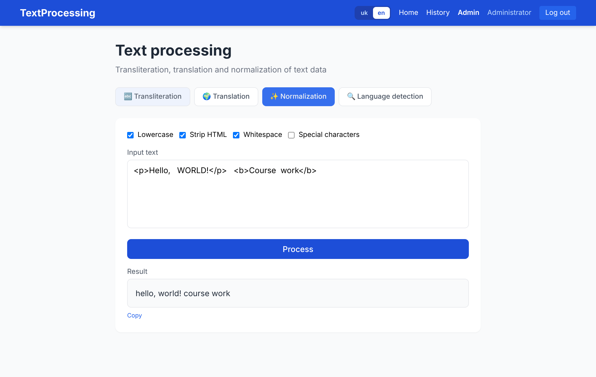
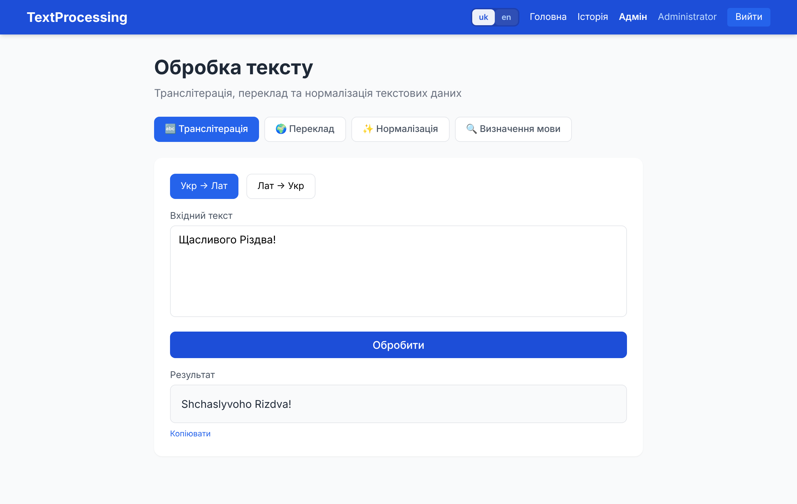
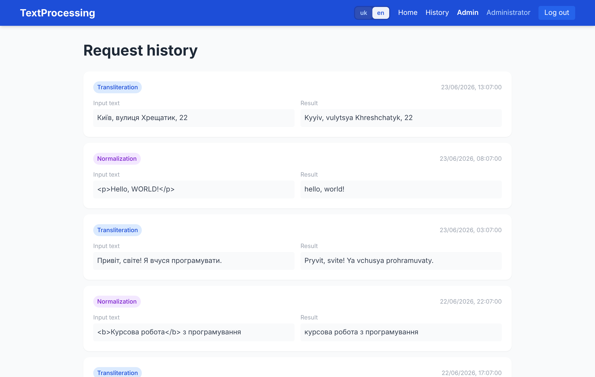
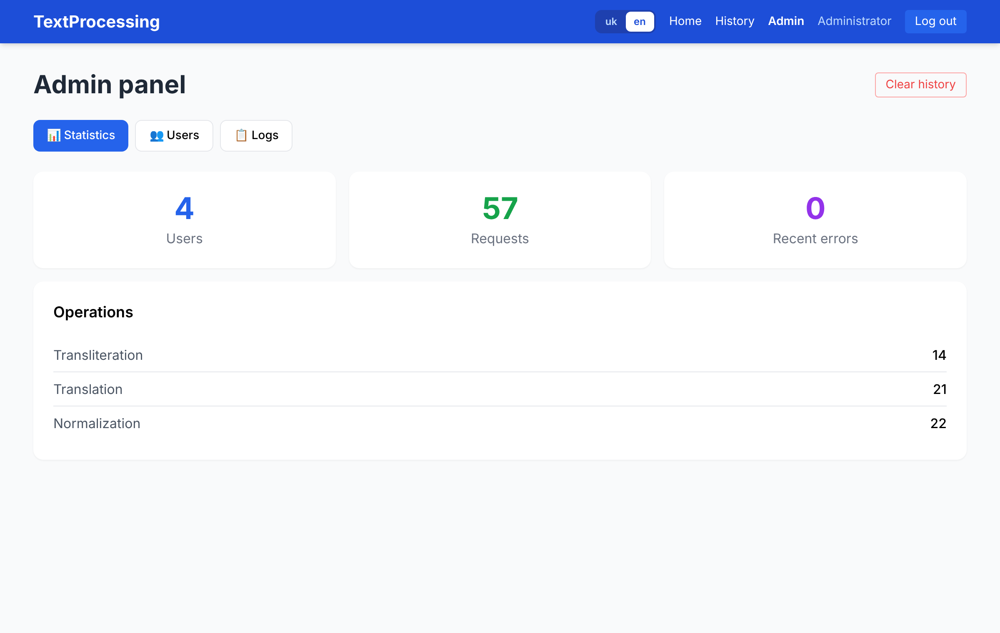
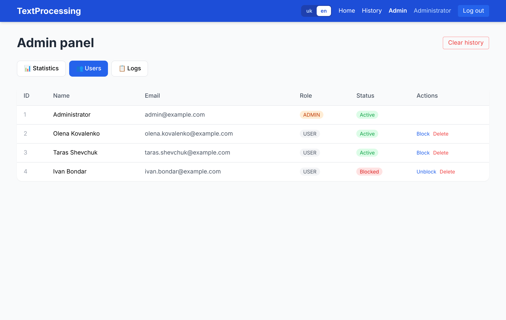

# Text Transliteration, Translation and Normalization Microservice


Coursework for the discipline "Development of Internet Computer Systems and Services".

A web service that transliterates Ukrainian text to Latin (and back), translates text between five languages, normalizes text, and detects its language. It has a REST API with JWT authentication, a Next.js interface available in Ukrainian and English, a request history, and an admin panel.



## Tech stack

**Backend:** Node.js, Express.js, Prisma ORM, PostgreSQL, JWT, Swagger, Winston  
**Frontend:** Next.js, React, Tailwind CSS, Axios  
**DevOps:** Docker, Docker Compose, GitHub Actions

## Features

- **Transliteration**: Ukrainian ↔ Latin (KMU 2010 standard)
- **Translation**: via LibreTranslate (UK, EN, PL, DE, FR)
- **Normalization**: removes HTML, extra whitespace and special characters, lowercases text
- **Language detection**: detects the language of a text automatically
- **Authentication**: registration, login, JWT tokens
- **Request history**: every operation is saved and can be viewed
- **Admin panel**: statistics, user management, logs
- **Bilingual interface**: Ukrainian and English, switched with the UK / EN buttons; the choice is remembered in the browser
- **Swagger UI**: interactive API documentation
- **Rate limiting**: protection against abuse

## Quick start

### Requirements

- Docker and Docker Compose

### Run

```bash
# 1. Clone the repository
git clone https://github.com/DxrkOmega/TextProcessingMicroservice.git
cd TextProcessingMicroservice

# 2. Create the .env file with your own secrets (see below)
cp .env.example .env

# 3. Start all services
docker compose up --build

# 4. Open in your browser
# Frontend:  http://localhost:3000
# API docs:  http://localhost:5000/api/docs
# Backend:   http://localhost:5000
```

### Secrets (`.env`)

`docker-compose.yml` contains no passwords or keys: it reads them from the `.env` file, and `docker compose up` refuses to start until `POSTGRES_PASSWORD` and `JWT_SECRET` are set. Open `.env` and fill in both values. Generate them with any of these commands:

```bash
# macOS / Linux
openssl rand -hex 32

# Node.js (any OS)
node -e "console.log(require('crypto').randomBytes(32).toString('hex'))"

# Windows PowerShell
-join ((1..32) | ForEach-Object { '{0:x2}' -f (Get-Random -Maximum 256) })
```

> The database password is applied only when the database volume is created. If you already started the project before and then change `POSTGRES_PASSWORD`, run `docker compose down -v` first (this deletes the stored data).

> ⚠️ On the first start LibreTranslate downloads its language models (about 1–2 minutes). Translation will not work until it is ready.

### Initial administrator

After the services are up, run the seed:

```bash
docker compose exec backend npm run seed
```

- Email: `admin@example.com`
- Password: `admin123`

These are demo credentials for local use only. Change the password (or do not run the seed) before exposing the service to anyone else.

### Language of the interface

Use the **UK / EN** switch in the top navigation bar (in the top-right corner on the sign-in and sign-up pages). The selected language is stored in the browser's `localStorage` under the key `lang`. All interface texts are in `frontend/lib/i18n.js`.

Error messages returned by the API are in Ukrainian; the interface translates the known ones into the selected language and shows unknown ones as they are.

## Screenshots

The screenshots below show the English interface.

| Sign in | Sign-up validation |
|---|---|
|  |  |

| Normalization | Ukrainian interface |
|---|---|
|  |  |

| Request history | Admin: statistics |
|---|---|
|  |  |

| Admin: users |
|---|
|  |

## Project structure

```
project/
├── backend/
│   ├── src/
│   │   ├── controllers/          # Request handling logic
│   │   │   ├── authController.js
│   │   │   ├── textProcessingController.js
│   │   │   └── adminController.js
│   │   ├── services/             # Business logic
│   │   │   ├── transliterationService.js
│   │   │   ├── translationService.js
│   │   │   └── normalizationService.js
│   │   ├── routes/               # REST API routes
│   │   │   ├── authRoutes.js
│   │   │   ├── textProcessingRoutes.js
│   │   │   └── adminRoutes.js
│   │   ├── middlewares/          # JWT, admin check, error handling
│   │   │   ├── authMiddleware.js
│   │   │   ├── adminMiddleware.js
│   │   │   └── errorHandler.js
│   │   ├── utils/
│   │   │   └── logger.js
│   │   └── app.js                # Express server
│   ├── prisma/
│   │   ├── schema.prisma         # Database schema
│   │   └── seed.js               # Initial data
│   ├── Dockerfile
│   └── package.json
├── frontend/
│   ├── pages/
│   │   ├── index.js              # Home: text processing
│   │   ├── login.js              # Sign-in page
│   │   ├── register.js           # Sign-up page
│   │   ├── history.js            # Request history
│   │   └── admin/index.js        # Admin panel
│   ├── components/
│   │   ├── Navbar.js             # Navigation bar
│   │   └── LangSwitch.js         # UK / EN switch
│   ├── lib/
│   │   └── i18n.js               # Interface strings (uk, en) and language context
│   ├── services/
│   │   └── api.js                # Axios client
│   ├── styles/globals.css
│   ├── Dockerfile
│   └── package.json
├── docs/screenshots/             # Images used in this README
├── .github/workflows/ci.yml      # CI/CD (GitHub Actions)
├── docker-compose.yml
├── README.md                     # this file (English)
└── README.uk.md                  # Ukrainian version
```

## API documentation

Swagger UI is available at `http://localhost:5000/api/docs`. The descriptions inside Swagger are in Ukrainian.

### Main endpoints

| Method | URL | Description |
|--------|-----|-------------|
| POST | `/api/auth/register` | Register |
| POST | `/api/auth/login` | Log in, get a JWT |
| GET | `/api/auth/me` | Current user |
| POST | `/api/text/transliterate` | Transliteration |
| POST | `/api/text/translate` | Translation |
| POST | `/api/text/normalize` | Normalization |
| POST | `/api/text/detect` | Language detection |
| GET | `/api/text/history` | Request history |
| GET | `/api/text/languages` | Supported translation languages |
| GET | `/api/admin/users` | List users (admin) |
| GET | `/api/admin/stats` | Statistics (admin) |
| GET | `/api/admin/logs` | Logs (admin) |
| GET | `/health` | Health check |

### Request examples

```bash
# Log in
curl -X POST http://localhost:5000/api/auth/login \
  -H "Content-Type: application/json" \
  -d '{"email":"admin@example.com","password":"admin123"}'

# Transliteration
curl -X POST http://localhost:5000/api/text/transliterate \
  -H "Authorization: Bearer <TOKEN>" \
  -H "Content-Type: application/json" \
  -d '{"text":"Привіт світ","direction":"uk-lat"}'
```

## Database

### Tables

**users**: system users  
**requests**: log of all requests  
**logs**: system logs

### ER diagram

```
users (id, email, password, name, role, isBlocked, createdAt)
  |
  └─< requests (id, userId, operationType, sourceText, resultText, createdAt)

logs (id, level, message, createdAt)
```

## Security

- JWT authorization (7 days)
- bcrypt password hashing (salt rounds: 12)
- Helmet.js for HTTP headers
- Rate limiting: 100 requests per 15 minutes
- CORS only from the allowed frontend origin
- SQL injection protection through the Prisma ORM
- Secrets (`JWT_SECRET`, the database password) are read from the `.env` file and are not stored in the repository.
- The database port is published on `127.0.0.1` only, so it is not reachable from the network.

Before deploying anywhere public:

- Do not use the demo administrator account (`admin@example.com` / `admin123`).
- Put the services behind HTTPS.

The `.env` file and the `logs/` directory are listed in `.gitignore` and must not be committed.

## CI/CD

GitHub Actions pipeline (`.github/workflows/ci.yml`):

1. Start a PostgreSQL service
2. Install dependencies
3. Run database migrations
4. Check that the backend starts
5. (main) Build the Docker images
